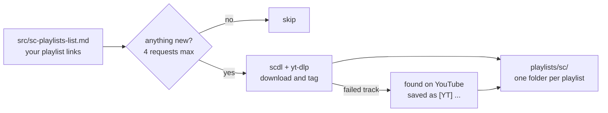

<div align="center">

# scsync

**Your SoundCloud playlists, on your disk.<br>A tool to download tracks for DJ and producers.**


</div>

A fork of [scdl](https://github.com/scdl-org/scdl) that keeps a whole list of playlists in sync.
No SoundCloud account or token needed; just a list of playlist links.



## What you get

```text
playlists/sc/
  Night drive/
    Artist - Title.m4a
    [YT] Artist - Not on SoundCloud anymore.m4a
    [unsync] Artist - Removed from the playlist.m4a
    my own edit.wav                                   ← yours, never touched
```

- **Only fetches what's new.** An unchanged playlist costs at most 4 requests and no download.
- **Never deletes your music.** A track removed from a playlist is renamed `[unsync] ...` and stays on disk. Files you add to a playlist folder are left alone.
- **Follows your changes.** A renamed playlist moves its folder. A new share link for the same playlist picks up where the old one stopped.
- **Tells a dead link from an empty playlist.** An expired secret link is reported with its line number instead of being read as "every track was removed".
- **Falls back to YouTube.** Tracks that fail on SoundCloud (DRM, or a 30-second GO+ preview instead of the song) are looked up on YouTube and saved with a `[YT]` tag.
- **Runs on its own.** A daily Windows task syncs at 18:00 and pings your phone only when something changed. The ping holds counts and line numbers, never names or links.
- **YouTube playlists too.** The same sync for YouTube, as m4a audio or small mp4 video.

## Setup

You need Python 3.10+, [uv](https://docs.astral.sh/uv/) and [ffmpeg](https://ffmpeg.org) on your PATH.

```powershell
uv sync
. .\.venv\Scripts\Activate.ps1
```

Then list your playlists in `src/sc-playlists-list.md`, one link per line. For a private playlist, paste its secret share link:

```text
https://soundcloud.com/<user>/sets/<playlist>
https://soundcloud.com/<user>/sets/<playlist>/s-<token>
```

Lines that don't start with `http` are ignored. The file is git-ignored, so your links stay on your machine.

## Daily use

```powershell
python src/sync_sc_playlists.py
```

It checks every playlist, downloads the new tracks, tries YouTube for the ones that failed, and lists any dead link by its line number. Run it with `--force-all` now and then to find tracks that were removed from a playlist.

To have it run by itself every day at 18:00, run this once from an admin PowerShell in the repo folder:

```powershell
powershell -ExecutionPolicy Bypass -File deploy\windows\register-task.ps1
```

For phone alerts, copy `.env.example` to `.env` and set an [ntfy](https://ntfy.sh) topic. See [docs/scheduled-sync.md](docs/scheduled-sync.md).

## Docs

| | |
| --- | --- |
| [Usage](docs/usage.md) | Every command and flag: SoundCloud, YouTube audio and video, GO+ tracks, logins, files and folders |
| [Scheduled sync](docs/scheduled-sync.md) | The daily Windows task, what an unattended run does differently, alerts |
| [How the sync works](docs/how-sync-works.md) | The fast check, archives, dead links, renames, and why |
| [Development](docs/development.md) | Updating yt-dlp and upstream scdl, tests, project layout, TODO |

## License

[GPL-2.0](LICENSE), like [scdl](https://github.com/scdl-org/scdl), which this is built on.
